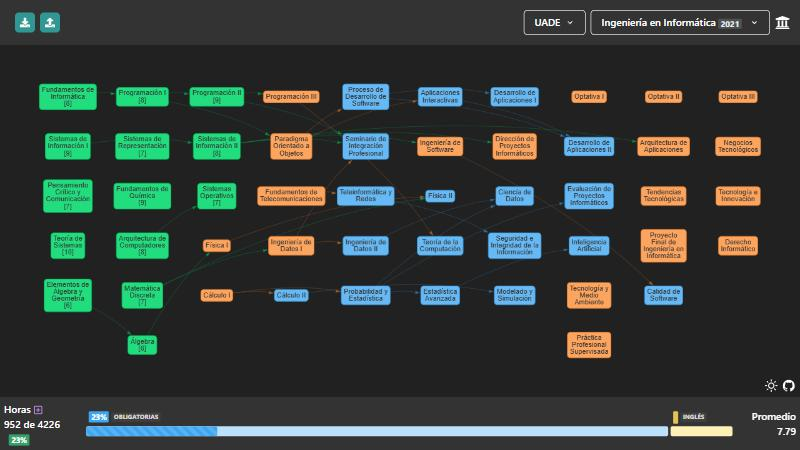

# [Mapa de Correlativas](https://matiasmarrassini.github.io/Mapa-Correlativas/)

Mapa interactivo de materias y correlativas, para distintas facultades.

Elegís tu facultad y tu carrera, marcás las materias que aprobaste y ves de un vistazo qué podés cursar, cuánto te falta y tu promedio. Hoy trae todas las carreras de la Facultad de Ingeniería de la UBA (FIUBA) e Ingeniería en Informática de la UADE (plan 2021), y está pensado para sumar más facultades sin tocar código.

<a href="https://matiasmarrassini.github.io/Mapa-Correlativas/"></a>

## Qué hace

- **Varias facultades:** primero se elige la facultad y después la carrera/plan.
- **Créditos u horas:** cada plan define cómo se mide el avance (FIUBA cuenta créditos, UADE horas) y si tiene CBC.
- **Correlativas:** las materias se habilitan cuando aprobás sus correlativas; al pasar el mouse se resaltan.
- **Progreso y promedio:** barra de avance por grupo (obligatorias, electivas, requisitos como el examen de inglés) y promedio con aplazos.
- **Planificación:** asignar materias a cuatrimestres futuros.
- **Optativas:** en los planes que lo declaran (UADE), elegís qué optativa cursás en cada lugar (buscando por nombre o código), con sus correlativas.
- **Sin cuentas ni servidor:** todo se guarda automáticamente en tu navegador.
- **Exportar / importar:** bajás tu avance a un `.json` y lo cargás en otro navegador (o lo usás de respaldo).

## Cómo correrlo

```sh
npm install
npm start   # http://localhost:3000/Mapa-Correlativas
npm test    # tests de datos, guardado y helpers
```

## Cómo agregar una facultad

1. Cargar cada plan como un json en `src/data/`. Cada materia es un objeto:

   ```json
   { "id": "3.4.071", "materia": "Programación I", "creditos": 68, "correlativas": "3.4.069", "categoria": "Materias Obligatorias", "level": 2 }
   ```

   - `creditos`: créditos u horas que otorga, según la unidad del plan.
   - `correlativas`: ids de las materias necesarias, separados por `-`.
   - `level`: columna donde se dibuja (por ejemplo, el cuatrimestre sugerido).
   - Si el plan tiene CBC, el json lleva el nodo `"CBC"` (como los de FIUBA); si no, no hace falta nada.

2. En `src/carreras.ts`:
   - sumar la facultad a `FACULTADES`;
   - agregar cada plan a `CARRERAS` (`unidad: "horas"` si no se cuentan créditos; `creditos.total`, y requisitos que no son materias en `creditos.checkbox`);
   - agruparlos en `PLANES` con su `facultad`;
   - si el plan tiene lugares de optativa para elegir, declararlos en `optativasDelPlan` (qué nodos son lugares y la lista de optativas, en otro json).

Los tests (`src/carreras.test.ts`) verifican que todas las correlativas existan y que cada plan esté en una facultad.

## Cambios respecto del original

Este proyecto es un fork de FIUBA-Map. Respecto del original:

- Selector de facultad y soporte para planes medidos en horas y sin CBC.
- Plan de Ingeniería en Informática de UADE (2021), con sus optativas para elegir.
- Sin login por padrón ni base de datos remota: guardado automático en `localStorage`, con exportar/importar.
- Tests con Jest para los datos, el guardado y los helpers de planes.

## Créditos

Basado en [FIUBA-Map](https://github.com/fdelmazo/FIUBA-Map) de Federico del Mazo (licencia MIT). Este fork mantiene la misma [licencia](LICENSE).
